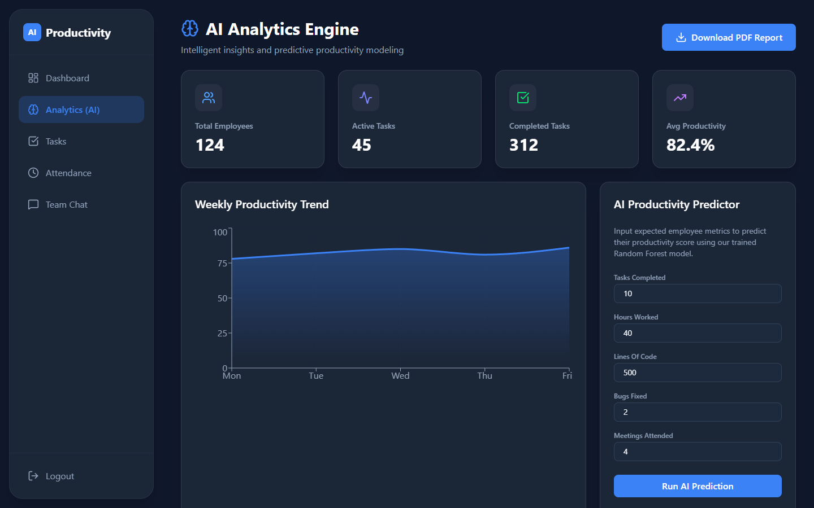
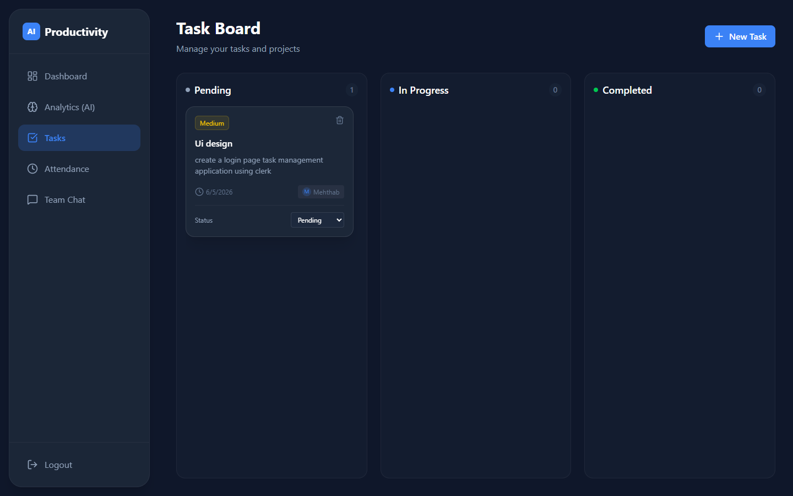
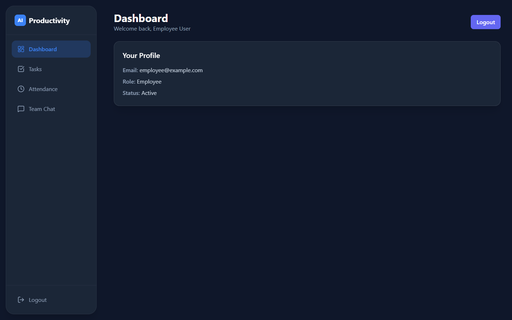
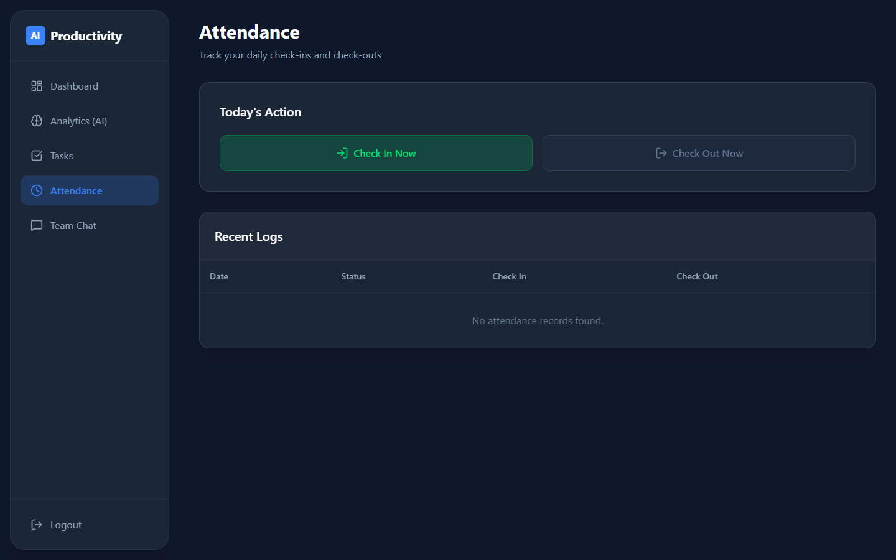
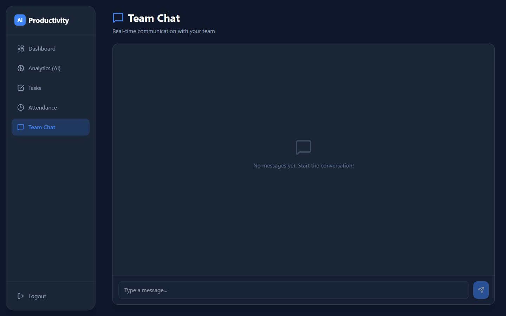
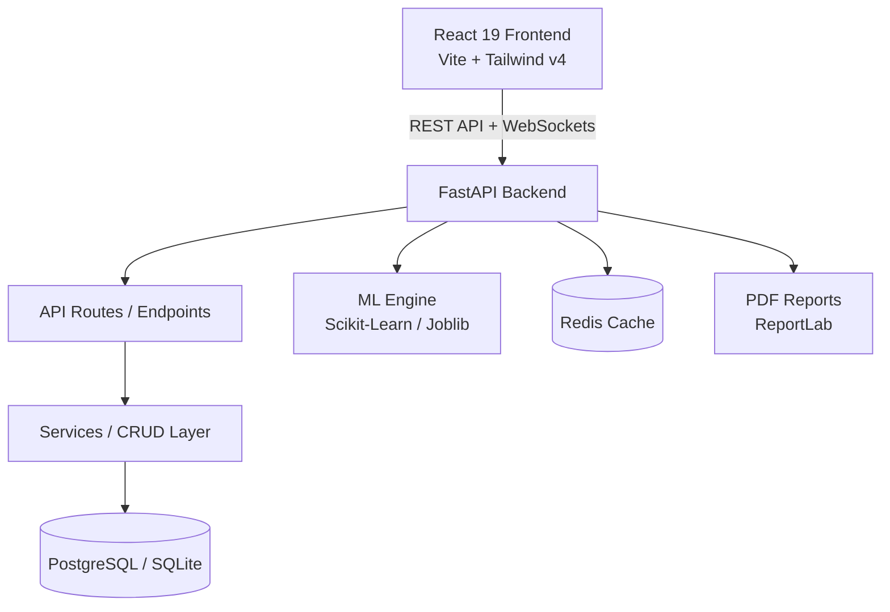

<div align="center">

# ⚡ QuickTask

**AI-powered employee task & productivity platform with real-time chat, attendance tracking, and predictive analytics.**

🏆 *Evolved from a 24-hour college hackathon project (BCA)*

[](https://mehthab7.github.io/QUICK_TASK/)
[](https://react.dev/)
[](https://fastapi.tiangolo.com/)
[](https://www.postgresql.org/)
[](https://scikit-learn.org/)
[](https://www.docker.com/)

[Live Demo](https://mehthab7.github.io/QUICK_TASK/) · [Original Hackathon Version](https://github.com/MEHTHAB-N-M/Task_Management_App) · [Report Bug](https://github.com/MEHTHAB7/QUICK_TASK/issues)

</div>

---

## 📑 Table of Contents

- [Overview](#overview)
- [Screenshots](#screenshots)
- [Features](#features)
- [Tech Stack](#tech-stack)
- [Architecture](#architecture)
- [Project Structure](#project-structure)
- [Getting Started](#getting-started)
  - [Prerequisites](#prerequisites)
  - [Option A: Docker (Recommended)](#option-a-docker-recommended)
  - [Option B: Local Development](#option-b-local-development)
- [API Reference](#api-reference)
- [Demo Credentials](#demo-credentials)
- [Deployment](#deployment)
- [Project Story](#project-story)
- [Author](#author)

---

## 📖 Overview

**QuickTask** helps companies manage employees, tasks, and attendance all in one place. Role-based dashboards give admins, managers, and employees tailored views for their workflows. A built-in machine learning engine scores productivity and predicts efficiency trends, while WebSocket-powered chat keeps teams connected in real time.

---

## 📸 Screenshots

| Admin Dashboard | AI Productivity Insights |
| :---: | :---: |
|  |  |

| Task Management Board | Employee Dashboard |
| :---: | :---: |
|  |  |

| Attendance Tracking | Real-Time Team Chat |
| :---: | :---: |
|  |  |

---

## ✨ Features

### 🔐 Access Control
- JWT authentication with role-based access control (**Admin**, **Manager**, **Employee**)
- Passwords hashed securely with **bcrypt**

### 📋 Task & Team Management
- Create, assign, and track tasks with priorities, statuses, and due dates
- Role-filtered task views
- Daily attendance check-in / check-out with duration analytics

### 🤖 AI Productivity Engine
- Productivity scoring and efficiency trend predictions using **Scikit-Learn**, **Pandas**, and **NumPy**
- AI-generated suggestions on the employee dashboard
- Predictive analytics and stats for administrators

### 💬 Real-Time Communication
- WebSocket team chat for live updates and instant messaging

### 📊 Reporting
- Automated PDF productivity reports generated via **ReportLab**

---

## 🧱 Tech Stack

| Layer | Technology |
| :--- | :--- |
| **Frontend** | React 19, Vite, Tailwind CSS v4, Framer Motion, Recharts, Lucide React |
| **Backend** | Python 3.11, FastAPI, SQLAlchemy, Alembic, WebSockets, PyJWT |
| **Database** | PostgreSQL (Docker/Production), SQLite (Local Dev) |
| **AI / ML** | Scikit-Learn, Pandas, NumPy, Joblib |
| **Reporting** | ReportLab |
| **DevOps & Cache** | Docker, Docker Compose, Nginx, Redis, GitHub Actions |

---

## 🏗️ Architecture



The backend follows a clean, layered design: **API routes → Services/CRUD → Database models**.

---

## 📂 Project Structure

```text
.
├── .github/          # GitHub Actions CI/CD workflows (Pages deployment)
├── backend/          # FastAPI app, ML models, and Alembic migrations
│   ├── alembic/      # Database migration scripts
│   ├── app/          # Core FastAPI routes, schemas, models, and CRUD
│   ├── ml_models/    # Saved trained models (joblib)
│   └── requirements.txt
├── frontend/         # React 19 + Tailwind CSS v4 Vite App
│   ├── src/          # Components, pages, services, and hooks
│   └── package.json
├── database/         # Database initialization scripts and schemas
├── docker/           # Docker configuration files
├── docs/             # Documentation and assets
├── ml_models/        # Pre-trained models and dataset generators
├── docker-compose.yml# Multi-container orchestration
└── README.md         # Project documentation
```

---

## 🚀 Getting Started

### Prerequisites

- **Node.js** (v18+)
- **Python** (3.10+)
- **Docker & Docker Compose** (optional, recommended)
- **PostgreSQL** (optional locally, SQLite is used by default)

---

### Option A: Docker (Recommended)

Run the full stack (Frontend, Backend, PostgreSQL, and Redis) with a single command:

```bash
docker-compose up -d --build
```

| Service | URL |
| :--- | :--- |
| **Frontend** | `http://localhost` |
| **Backend API** | `http://localhost:8000` |
| **API Docs (Swagger)** | `http://localhost:8000/docs` |

To stop all services:
```bash
docker-compose down
```

---

### Option B: Local Development

#### 1. Backend

```bash
cd backend

# Create virtual environment
python -m venv venv

# Activate virtual environment
# Windows (PowerShell):
.\venv\Scripts\Activate.ps1
# Windows (cmd):
.\venv\Scripts\activate.bat
# Linux / macOS:
source venv/bin/activate

# Install dependencies
pip install -r requirements.txt

# Run migrations (creates app.db if using SQLite)
alembic upgrade head

# Start the FastAPI server
uvicorn app.main:app --reload --host 0.0.0.0 --port 8000
```
Backend API will be live at `http://localhost:8000` (Swagger UI: `http://localhost:8000/docs`).

#### 2. Frontend

```bash
cd frontend

# Install npm dependencies
npm install

# Start Vite dev server
npm run dev
```
Frontend will be running at `http://localhost:5173`.

---

## 📡 API Reference

Interactive Swagger documentation is available at: **`http://localhost:8000/docs`**

| Method | Endpoint | Description |
| :--- | :--- | :--- |
| `POST` | `/api/v1/auth/login` | Authenticate user and receive JWT access token |
| `POST` | `/api/v1/users/` | Create a user / employee |
| `GET` | `/api/v1/tasks/` | List tasks (filtered by authenticated user's role) |
| `POST` | `/api/v1/tasks/` | Create a new task |
| `POST` | `/api/v1/attendance/check-in` | Record daily employee check-in |
| `POST` | `/api/v1/attendance/check-out` | Record employee check-out |
| `GET` | `/api/v1/attendance/` | Get attendance history for the authenticated user |
| `GET` | `/api/v1/analytics/dashboard-stats` | Aggregated dashboard statistics and trends |
| `POST` | `/api/v1/analytics/predict-productivity` | AI productivity prediction based on metrics |
| `GET` | `/api/v1/reports/productivity-report` | Generate a downloadable PDF report |
| `WS` | `/api/v1/ws/chat` | WebSocket channel for real-time team communication |

---

## 🔑 Demo Credentials

The seeded local database (`backend/app.db`) includes the following demo accounts:

| Role | Email | Password | Description |
| :--- | :--- | :--- | :--- |
| **Admin** | `admin@example.com` | `password123` | Full administrative control & predictive analytics |
| **Manager** | `manager@example.com` | `password123` | Team task assignment and productivity monitoring |
| **Employee** | `employee@example.com` | `password123` | Employee task execution & attendance tracking |
| **Employee** | `mehthab@gmail.com` | `12345678` | Personal task board & tracking |

> [!NOTE]
> These credentials are for demo/evaluation purposes only. Update or remove them before any production deployment.

---

## ☁️ Deployment

### Frontend (GitHub Pages)

The frontend automatically deploys to GitHub Pages using the included workflow ([`.github/workflows/deploy.yml`](.github/workflows/deploy.yml)):

1. In GitHub, navigate to **Settings** → **Pages**.
2. Under **Build and deployment** → **Source**, select **GitHub Actions**.
3. Push to `main` (or run the workflow manually from the **Actions** tab).
4. Live site: **`https://mehthab7.github.io/QUICK_TASK/`**

### Connecting to a Hosted Backend

When deploying your FastAPI backend on cloud platforms (such as Render, Railway, Fly.io, or VPS), configure the following environment variables under **Settings** → **Secrets and variables** → **Actions**:

| Variable | Example Value | Description |
| :--- | :--- | :--- |
| `VITE_API_BASE_URL` | `https://your-api.onrender.com/api/v1` | Base REST API endpoint |
| `VITE_WS_BASE_URL` | `wss://your-api.onrender.com/api/v1/ws/chat` | Real-time WebSocket endpoint |

---

## 📚 Project Story

QuickTask originated as [Task_Management_App](https://github.com/MEHTHAB-N-M/Task_Management_App), a 24-hour hackathon project built during BCA. 

This repository is an enterprise-grade evolution built with:
- **Role-Based Access Control** (Admin, Manager, Employee)
- **AI/ML Productivity Engine** for real-time score prediction
- **Real-Time WebSocket Chat** for team communication
- **Attendance Management & PDF Reporting**
- **Dockerized Container Architecture** and automated CI/CD deployment

---

## 👨‍💻 Author

**Mehthab N M** — *Full-Stack & Python Developer*

- 🌐 [Portfolio](https://mehthab-n-m.github.io/My_portfolio/)
- 🐙 [GitHub](https://github.com/MEHTHAB-N-M)
- 💼 [LinkedIn](https://www.linkedin.com/in/mehthab-n-m-637611344)

---

<div align="center">
⭐ If you find this project helpful or inspiring, please give it a star!
</div>
